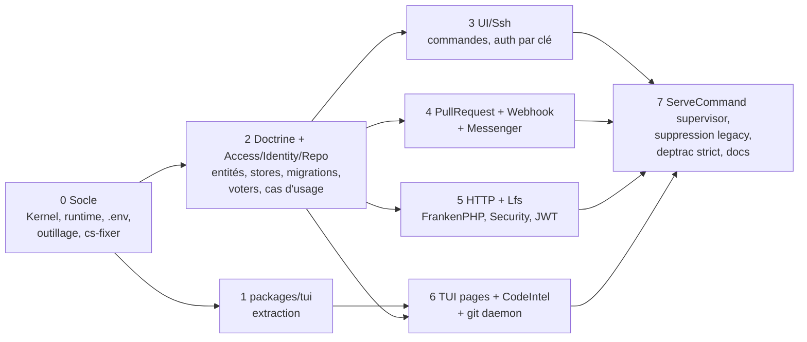

# TECH — Restructuration de `codes.sh` en monolithe modulaire Symfony

Statut : proposé · Cible : PHP 8.5, Symfony 8.1 (dont `symfony/tui`), Doctrine ORM 3, FrankenPHP · Dépôt sans commit : références = chemins relatifs à `codes.sh/` à l'état du 2026-11-04 (baseline `vendor/bin/phpunit tests` : 158 tests / 866 assertions OK).

Décisions déjà actées :
- Architecture **option C** : modules par domaine (`src/<Module>/{Domain,Application,Infrastructure}`) + couche `src/UI/*`, dans le modèle Symfony standard (Kernel, autowiring, attributs).
- **Doctrine ORM** (mapping par attributs) + **doctrine/migrations**, **schéma repensé** : aucune compatibilité avec `soft-serve.db` existant ni avec les tables Go.
- **FrankenPHP** (mode worker) pour le HTTP.

## 1. Contexte

`codes.sh` est un portage PHP de `codes.sh.src` (Soft Serve, Go) qui reprend 1:1 le découpage des paquets Go, avec Symfony utilisé comme simple bibliothèque. 23,6 k lignes (src + tests).

### 1.1 Amorçage et DI
- `bin/console` et `bin/soft:96-111` construisent un `ContainerBuilder` à la main, le **recompilent à chaque appel** et instancient toutes les commandes (dont `TermstrapRenderer` → tentative FFI) même pour `admin migrate`. Chaque connexion SSH (`authorized_keys` → `soft:ssh:dispatch`) et chaque hook git paie ce coût.
- `config/services.yaml` : `public: true`, `config/packages/` vide, pas de `.env`, pas de `phpunit.xml`, pas de PHPStan/cs-fixer. Indentation mixte (1 espace dans `Service/*`, 4 dans `Command/*`).
- DI contournée : `SelectionPage.php:65-68` (`new DatabaseManager()` + `new BackendService(new DataStore(...))`), `RepoPage.php:114` (`new GitPlumbingService()`), `SshCommandDispatcher.php:40-41` (`?? new JwtManager()`), constructeurs à scalaires nullables (`DatabaseManager`, `ServerConfig`, `CodeIntelService`, `LfsStorageService`, `JwtManager`, `TermstrapRenderer`) avec repli `getenv()` / `dirname(__DIR__, N).'/.data'`.

### 1.2 Données et métier
- `Service/Database/DatabaseManager.php` (873 l.) : PDO brut + 5 migrations en closures (l. 207-386), tables doublées `schema_migrations`/`migrations`, vue `collab`, colonnes redondantes `repos.parent_repo_id`/`is_fork` (= `fork_id`), `lastInsertId()` non fiable sur Postgres.
- `Service/Store/DataStore.php` (947 l.) : un seul store pour tous les agrégats ; dépôts, tokens, livraisons et collaborateurs renvoyés en `array` ; requêtes N+1 (`hydrateUser`, `hydrateWebhook`) ; `getNextPullRequestNumber` = `MAX+1` sans transaction ; tokens d'accès **en clair** ; mots de passe **non hachés**.
- `Service/Backend/BackendService.php` (965 l.) : façade globale par noms (alias `getRepo`/`getRepository`, `getUser`/`getUserByUsername`…), règles métier mêlées à des effets de bord (`git init` l. 264-268, `rename()` de répertoire).
- Règles cassées ou divergentes de Go relevées pendant l'analyse :
  - `mergePullRequest` (l. 529-562) ne fait **que** changer l'état en base ; `GitPlumbingService::mergePullRequest` (l. 469) n'est appelé par personne.
  - `deletePullRequest` (l. 866) sans autorisation ; `getPullRequest`/`listPullRequests`/`listPullRequestComments` sans contrôle d'accès.
  - `forkRepo` (l. 351) crée la ligne sans cloner ; `deleteRepo` laisse le dépôt sur disque ; `deleteUser` cascade sur les dépôts.
  - `getAccessLevel` (l. 59-106) diverge de Go `pkg/backend/user.go` (dépôt inexistant, anon > RW).
  - Webhooks : seuls `push`/`branch_tag` émis ; `WebhookDispatcher::dispatch(performHttp: false)` par défaut et aucun appelant ne passe `true` → **aucun appel HTTP réel en production** (livraison fictive `200`). `fopen($url)` re-résout le DNS après `SsrfValidator` (fenêtre TOCTOU).
  - `JwtManager::verifyToken` n'a aucun appelant ; secret HS256 par défaut codé en dur.

### 1.3 Points d'entrée
- **SSH** : `Service/Ssh/SshCommandDispatcher.php` (2 203 l.) — tokenizer shell maison (l. 321-370), parseur d'options maison (l. 379-436), ~70 closures `match`, ~45 sous-commandes (`repo *`, `pr *`, `collab *`, `user *`, `settings *`, `pubkey *`, `token *`, `jwt`, `info`, `help`), contrôle d'accès ad hoc (`requireRepo` l. 524-562 qui **révèle l'existence** des dépôts privés, `isServerAdmin` l. 478-512 qui accorde l'admin aux noms `admin`/`root`), chemins de repli vers des répertoires arbitraires (`resolveRepoPath` l. 291-314). `ServerCommand` écrit `authorized_keys` **sans** `--key-fingerprint` → toute session SSH est anonyme.
- **HTTP / LFS / daemon** : `Web/GitHttpBackendService`, `Lfs/LfsStorageService`, `Daemon/GitDaemonService` renvoient des tableaux `{status, headers, body}` et **ne sont appelés que par les tests** ; `ServerCommand.php:261-286` annonce HTTP/Git daemon/Stats puis lance seulement `sshd` via `passthru`. `LfsStorageService` crée son propre schéma `sqlite::memory:` (table `users(is_admin)` fantôme).
- **Hooks** : `Command/Hook*Command` + `CustomHookTrait` ; les noms `soft:hook:*` sont gravés dans les scripts générés par `GitPlumbingService::installServerHooks` (l. 569-640).
- **TUI** : framework générique (`Tui/Runtime`, `Style`, `Event`, `Keymap`, composants) + pages applicatives (`RootUI`, `SelectionPage`, `RepoPage`, `AdminPage`) construites par `new`. Bugs latents : import manquant `TextAreaField` (`SelectionPage.php:503`), méthode inexistante `GitService::getReadme()` (`SelectionPage.php:291`) et `forkRepository()` (`SelectionPage.php:386`), `CodeIntelService` jamais passé à `RepoPage` (`RootUI.php:50`, `BrowseCommand.php:54`), `AdminPage` sans persistance.

## 2. Changements proposés

### 2.1 Arborescence cible

```
codes.sh/
  bin/console                 # symfony/runtime
  bin/soft                    # mapping "soft admin migrate" -> commandes, rien d'autre
  public/index.php            # front controller (FrankenPHP worker)
  Caddyfile                   # FrankenPHP
  config/{bundles.php, packages/*.yaml, routes.yaml, services.yaml}
  migrations/Version*.php
  packages/tui/               # temporaire : framework TUI maison, supprimé en phase 6 au profit de symfony/tui
  src/
    Kernel.php
    Shared/      Domain/{Exception/, Event/DomainEvent.php, DurationParser.php}
                 Infrastructure/{Config/ServerSettings.php, Git/PktLine.php, Git/GitProcessFactory.php,
                                 Security/SsrfGuard.php, Server/*}
    Access/      Domain/{AccessLevel.php, ServerSetting.php, SettingKey.php}
                 Application/{AccessResolver.php, ServerPolicy.php}
                 Infrastructure/{Security/RepoVoter.php, Security/ServerAdminVoter.php, Doctrine/*}
    Identity/    Domain/{Model/User.php, Model/PublicKey.php, Model/AccessToken.php, SshKey.php,
                         UserStore.php, AccessTokenStore.php, Event/*}
                 Application/{CreateUser.php, DeleteUser.php, RenameUser.php, SetAdmin.php,
                              AddPublicKey.php, RemovePublicKey.php, IssueAccessToken.php,
                              RevokeAccessToken.php, AuthenticateSshKey.php, AuthenticateAccessToken.php,
                              BootstrapServer.php}
                 Infrastructure/{Doctrine/*, Security/SecurityUser.php, Ssh/AuthorizedKeysFileWriter.php}
    Repo/        Domain/{Model/Repo.php, Model/Collaborator.php, RepoName.php, RepoStore.php,
                         Git/{GitRepository.php, Commit.php, TreeEntry.php, Refs.php, Diff.php, DiffFile.php},
                         Event/*}
                 Application/{CreateRepo.php, ImportRepo.php, ForkRepo.php, DeleteRepo.php, RenameRepo.php,
                              UpdateRepoSettings.php, AddCollaborator.php, RemoveCollaborator.php,
                              DeleteBranch.php, SetDefaultBranch.php, DeleteTag.php, RecordPush.php,
                              Query/RepoQuery.php}
                 Infrastructure/{Doctrine/*, Git/GitRepositoryReader.php, Git/GitRepositoryWriter.php,
                                 Git/BareRepositoryStorage.php (implémente Domain/RepoDirectory), Git/HookInstaller.php, Git/CustomHookRunner.php,
                                 Git/GitServiceProcess.php}
    PullRequest/ Domain/{Model/PullRequest.php, Model/Comment.php, PullRequestStatus.php, PullRequestStore.php, Event/*}
                 Application/{OpenPullRequest.php, UpdatePullRequest.php, MergePullRequest.php,
                              ClosePullRequest.php, ReopenPullRequest.php, DeletePullRequest.php,
                              CommentPullRequest.php, Query/PullRequestQuery.php}
                 Infrastructure/{Doctrine/*, Security/PullRequestVoter.php}
    Webhook/     Domain/{Model/Webhook.php, Model/Delivery.php, WebhookEvent.php, ContentType.php, WebhookStore.php}
                 Application/{CreateWebhook.php, DeleteWebhook.php, Message/SendWebhook.php,
                              SendWebhookHandler.php, WebhookEventSubscriber.php, PayloadFactory.php, Signer.php}
                 Infrastructure/Doctrine/*
    Lfs/         Domain/{Model/LfsObject.php, Model/LfsLock.php, LfsPointer.php, Oid.php, LfsObjectStore.php, LfsLockStore.php}
                 Application/{Batch.php, UploadObject.php, DownloadObject.php, VerifyObject.php, LockService.php, IssueLfsToken.php}
                 Infrastructure/{Doctrine/*, FilesystemObjectStorage.php, Jwt/JwtIssuer.php, Jwt/JwtVerifier.php}
    CodeIntel/   Domain/{Occurrence.php, SymbolInfo.php, SymbolLocation.php, IndexStore.php}
                 Application/{CodeIntelQuery.php, Message/IndexCommit.php, IndexCommitHandler.php, PushIndexSubscriber.php}
                 Infrastructure/{Scip/ScipProtobufCodec.php, FilesystemIndexStore.php, GitArchiveExtractor.php,
                                 Indexer/{ScipGoIndexer.php, ScipPhpIndexer.php, NativePhpIndexer.php}}
    UI/
      Console/Command/{ServeCommand.php, BrowseCommand.php, TuiCommand.php,
                       Admin/{BootstrapCommand.php, SyncHooksCommand.php, ReindexCodeIntelCommand.php},
                       Hook/{PreReceiveCommand.php, UpdateCommand.php, PostReceiveCommand.php, PostUpdateCommand.php},
                       Dev/RenderSmokeCommand.php}
      Ssh/{SshEntrypointCommand.php, SshCliApplication.php, SshCommandResolver.php, SshSession.php,
           GitTransportRunner.php, ExceptionRenderer.php,
           Command/{Repo/*, Repo/Branch/*, Repo/Tag/*, Repo/Webhook/*, Collab/*, PullRequest/*,
                    User/*, Settings/*, Pubkey/*, Token/*, JwtCommand.php, InfoCommand.php, UsernameCommand.php}}
      Http/{Controller/{GitSmartHttpController.php, GitDumbHttpController.php, GoGetController.php,
                        LfsBatchController.php, LfsObjectController.php, LfsLockController.php},
            Security/{AccessTokenAuthenticator.php, JwtAccessTokenHandler.php},
            EventListener/DomainExceptionListener.php}
      GitDaemon/{GitDaemonCommand.php, GitDaemonProtocol.php}
      Tui/{TuiPageFactory.php, Page/{RootUI,SelectionPage,RepoPage,AdminPage}.php,
           Render/TermstrapRenderer.php (implémente CodesSh\Tui\Component\SnippetRenderer)}
  tests/{Unit,Integration,Functional}/<Module>/...
```

Règles de dépendance (vérifiées par **deptrac**, `deptrac.yaml`) :
- `*/Domain` → uniquement `Shared/Domain` et le `Domain` d'autres modules (référence par entité permise : `Repo` → `Identity\Domain\Model\User`).
- `*/Application` → `Domain` (tous modules), `Shared`, contrats Symfony (`EventDispatcherInterface`, `MessageBusInterface`, `Security`).
- `*/Infrastructure` → tout sauf `UI`.
- `UI/*` → `Application` + `Domain` ; jamais `Infrastructure/Doctrine` directement.
- `packages/tui` (temporaire) → aucune dépendance `App\`.

Compromis assumé : les entités du `Domain` portent les attributs `#[ORM\…]` (convention Symfony, pas de mapping XML). Les interfaces `*Store` existent pour chaque agrégat (implémentations `Doctrine*Store extends ServiceEntityRepository`, alias autowiring automatique car implémentation unique). Les classes git (`GitRepositoryReader`, `GitRepositoryWriter`, `BareRepositoryStorage`) restent **concrètes** : une seule implémentation, testée contre de vrais dépôts temporaires comme aujourd'hui.

### 2.2 Socle Symfony (Kernel, config, outillage)

- Dépendances ajoutées : `symfony/framework-bundle`, `runtime`, `dotenv`, `security-bundle`, `messenger`, `scheduler`, `http-client`, `validator`, `password-hasher`, `clock`, `uid`, `monolog-bundle`, `doctrine/doctrine-bundle`, `doctrine/orm`, `doctrine/doctrine-migrations-bundle`, `lcobucci/jwt`, `runtime/frankenphp-symfony` (ou support natif `symfony/runtime` si présent). Dev : `phpstan/phpstan` + `phpstan-symfony` + `phpstan-doctrine`, `friendsofphp/php-cs-fixer`, `qossmic/deptrac`, `dama/doctrine-test-bundle`, `symfony/maker-bundle`.
- `src/Kernel.php` (`MicroKernelTrait`) ; `bin/console` via `symfony/runtime` ; conteneur et métadonnées Doctrine en cache (`cache.system`) — impératif car `bin/console` est lancé à chaque session SSH et chaque hook.
- `config/services.yaml` : `public: false`, exclusions `src/*/Domain/{Model,Event}/`, `src/Kernel.php` ; bloc dédié aux commandes SSH (voir 2.5).
- **Configuration** : `Service/Config/ServerConfig.php` est supprimé, ainsi que la lecture de `config.yaml`. Toutes les valeurs passent par `.env` / variables d'environnement en gardant les noms `SOFT_SERVE_*` existants (opérations inchangées). Un objet immuable `Shared\Infrastructure\Config\ServerSettings` est construit par DI depuis `config/packages/codes_sh.yaml` :

```yaml
parameters:
  codes_sh.data_path: '%env(default:codes_sh.default_data_path:SOFT_SERVE_DATA_PATH)%'
  codes_sh.default_data_path: '%kernel.project_dir%/.data'
services:
  App\Shared\Infrastructure\Config\ServerSettings:
    arguments:
      $name: '%env(default::SOFT_SERVE_NAME)%'
      $dataPath: '%codes_sh.data_path%'
      $sshListenAddr: '%env(SOFT_SERVE_SSH_LISTEN_ADDR)%'
      $sshPublicUrl: '%env(SOFT_SERVE_SSH_PUBLIC_URL)%'
      $httpPublicUrl: '%env(SOFT_SERVE_HTTP_PUBLIC_URL)%'
      $gitListenAddr: '%env(SOFT_SERVE_GIT_LISTEN_ADDR)%'
      $gitMaxConnections: '%env(int:SOFT_SERVE_GIT_MAX_CONNECTIONS)%'
      $lfsEnabled: '%env(bool:SOFT_SERVE_LFS_ENABLED)%'
      $initialAdminKeys: '%env(default::SOFT_SERVE_INITIAL_ADMIN_KEYS)%'
```
  Plus aucun `getenv()` / `$_SERVER` dans `src/` (règle PHPStan `disallowed-calls`), sauf dans `UI/Ssh/SshEntrypointCommand` pour `SSH_ORIGINAL_COMMAND` (contrat sshd).
- Outillage : `phpunit.xml.dist` (`APP_ENV=test`, extension DAMA), `phpstan.dist.neon` niveau max + baseline initiale, `.php-cs-fixer.dist.php` (`@Symfony`, `@PER-CS`), `deptrac.yaml`. Cibles Makefile `lint`, `stan`, `cs`, `deptrac`, `test` (une seule).

### 2.3 Schéma Doctrine (repensé)

Conventions : PK `id` entier identité ; horodatages `datetime_immutable` en UTC (`symfony/clock`) ; enums PHP via `enumType` ; noms de tables au pluriel snake_case ; FK explicites.

| Entité (table) | Colonnes | Contraintes |
|---|---|---|
| `Identity\User` (`users`) | `username` (string 64), `is_admin` bool, `password_hash` ?string, `created_at`, `updated_at` | UNIQUE(username) |
| `Identity\PublicKey` (`user_public_keys`) | `user_id`, `algorithm`, `key_data` (base64 normalisé), `fingerprint` (`SHA256:…`), `comment` ?string, `created_at` | UNIQUE(fingerprint) ; FK user CASCADE |
| `Identity\AccessToken` (`user_access_tokens`) | `user_id`, `name`, `token_hash` (sha256 hex), `expires_at` ?, `last_used_at` ?, `created_at` | UNIQUE(token_hash) ; FK user CASCADE |
| `Access\ServerSetting` (`server_settings`) | `name` (enum `SettingKey` : `anon_access`, `allow_keyless`) PK, `value` string, `updated_at` | — |
| `Repo\Repo` (`repos`) | `name`, `project_name`, `description`, `is_private`, `is_mirror`, `is_hidden`, `owner_id`, `fork_of_id` ?, `next_pull_request_number` int (défaut 1), `created_at`, `updated_at` | UNIQUE(name) ; FK owner **RESTRICT** (`DeleteUser` refuse si dépôts, parité Go `ErrUserOwnsRepos`) ; FK fork_of SET NULL |
| `Repo\Collaborator` (`repo_collaborators`) | `repo_id`, `user_id`, `access_level` (enum int `AccessLevel`), `created_at`, `updated_at` | UNIQUE(repo_id, user_id) ; FKs CASCADE |
| `PullRequest\PullRequest` (`pull_requests`) | `repo_id`, `number`, `title`, `description`, `status` (enum string `open|merged|closed`), `base_ref`, `base_commit`, `head_repo_id`, `head_ref`, `head_commit`, `author_id`, `merge_commit` ?, `merged_by_id` ?, `merged_at` ?, `closed_at` ?, `created_at`, `updated_at` | UNIQUE(repo_id, number) ; INDEX(repo_id, status) ; FK repo/head_repo CASCADE, author CASCADE, merged_by SET NULL |
| `PullRequest\Comment` (`pull_request_comments`) | `pull_request_id`, `author_id`, `body`, `commit_sha` ?, `file_path` ?, `line` ?, `created_at`, `updated_at` | FKs CASCADE |
| `Webhook\Webhook` (`webhooks`) | `repo_id`, `url`, `secret`, `content_type` (enum `json|form`), `is_active`, `events` (json, liste d'enum `WebhookEvent` ; vide = tous), `created_at`, `updated_at` | UNIQUE(repo_id, url) ; FK CASCADE |
| `Webhook\Delivery` (`webhook_deliveries`) | `id` UUID v7 PK, `webhook_id`, `event`, `request_url`, `request_method`, `request_headers` json, `request_body`, `request_error` ?, `response_status` ?int, `response_headers` ?json, `response_body` ?text, `duration_ms` ?int, `created_at` | INDEX(webhook_id, created_at) ; FK CASCADE |
| `Lfs\LfsObject` (`lfs_objects`) | `repo_id`, `oid` (char 64), `size` **bigint**, `created_at` | UNIQUE(repo_id, oid) ; FK CASCADE |
| `Lfs\LfsLock` (`lfs_locks`) | `repo_id`, `owner_id`, `path`, `ref_name` ?, `created_at` | UNIQUE(repo_id, path) ; FKs CASCADE |
| Messenger (`messenger_messages`) | transport Doctrine `async` | géré par Messenger |

Supprimé : vue `collab`, tables `schema_migrations`/`migrations` (→ `doctrine_migration_versions`), `webhook_events` (→ colonne json), `repos.parent_repo_id`/`is_fork`, `settings` libre (→ clés typées).

Numérotation des PR : dans la transaction de `OpenPullRequest`, un `UPDATE repos SET next_pull_request_number = next_pull_request_number + 1 WHERE id = :id` (DBAL) précède la relecture du compteur. L'`UPDATE` prend le verrou d'écriture (verrou de ligne sous Postgres, verrou de base sous SQLite), ce qui sérialise les ouvertures concurrentes sans SQL spécifique au dialecte — remplace `MAX(number)+1`.

SQLite : `journal_mode=WAL`, `busy_timeout=5000`, `foreign_keys=ON` posés par un middleware DBAL (`Shared\Infrastructure\Doctrine\SqlitePragmaMiddleware`) — nécessaire car web, worker Messenger, daemon et hooks écrivent en concurrence.

Données existantes : `.data/soft-serve.db` est abandonné (`make clean-all` puis `soft admin bootstrap`). Les dépôts nus restent sur disque mais ne réapparaissent qu'une fois réenregistrés (comportement actuel : la liste vient de la base).

`DatabaseManager::ensureBootstrapped` (seed `admin`, clés initiales, réglages) devient le cas d'usage `Identity\Application\BootstrapServer`, exposé par `soft:admin:bootstrap` et appelé par `ServeCommand` ; il n'est **plus** déclenché implicitement par les constructeurs.

### 2.4 Modules : cas d'usage, règles, événements

Chaque cas d'usage est une classe `final readonly` invocable, prenant un DTO d'entrée et l'acteur (`?User`), qui : valide, vérifie l'accès via `AuthorizationCheckerInterface` (voters), modifie les entités, `flush`, puis dispatch les événements de domaine. Erreurs = hiérarchie `Shared\Domain\Exception\{NotFound, AccessDenied, Conflict, InvalidInput}` (équivalents de `pkg/proto/errors.go`).

**Access** — `AccessLevel` (enum int conservé, `fromString` limité aux valeurs canoniques Go + alias actuels documentés). `AccessResolver::levelFor(?User, ?Repo, RepoName)` porte l'algorithme Go `pkg/backend/user.go` (admin → Admin ; dépôt absent : utilisateur → max(anon, RW) sauf répertoire orphelin → NoAccess ; propriétaire → Admin ; collaborateur → max(anon si public, niveau) ; privé → NoAccess ; public → max(anon, RO) pour un utilisateur, anon sinon). `ServerPolicy` lit `server_settings` avec repli env (`SOFT_SERVE_ANON_ACCESS`, `SOFT_SERVE_ALLOW_KEYLESS`). Voters : `RepoVoter` (attributs `REPO_READ`, `REPO_WRITE`, `REPO_ADMIN`, `REPO_CREATE`), `ServerAdminVoter` (`SERVER_ADMIN` = `User::isAdmin()` uniquement ; suppression du passe-droit `admin`/`root`). Sémantique `denyRead` Go : un dépôt illisible lève `NotFound` pour un utilisateur authentifié et `AccessDenied` pour un anonyme — appliqué dans `Repo\Application\Query\RepoQuery::getReadable()`, unique point d'accès en lecture.

**Identity** — `SshKey` (VO, ex-`SshKeyComparator` : parse OpenSSH, fingerprint SHA256 sans padding, comparaison constant-time). `AuthenticateSshKey(fingerprint)` → `?User`. Tokens : format `ss_` + 40 hex (parité Go), seul le hash sha256 est stocké, valeur affichée une fois. Mots de passe : `UserPasswordHasherInterface` (`auto`). Événements : `PublicKeyAdded`, `PublicKeyRemoved`, `UserDeleted` → `AuthorizedKeysFileWriter` régénère `%data%/ssh/authorized_keys` (une ligne par clé : `command="<php> <console> soft:ssh:dispatch --key-fingerprint=SHA256:…",no-port-forwarding,no-X11-forwarding,no-agent-forwarding <clé>`). Choisi plutôt que `AuthorizedKeysCommand` de sshd, qui impose un binaire possédé par root (bloquant en dev macOS).

**Repo** — `RepoName` (VO : ex-`sanitizeRepoName` + règles Go `ValidateRepo`). `BareRepositoryStorage` regroupe tous les effets disque aujourd'hui dispersés (`BackendService:264`, `SshCommandDispatcher:215,814,1025,1069,1141,1157,1218`) : `init`, `cloneFork`, `importMirror` (avec `SsrfGuard`), `delete`, `rename`, `pathFor(RepoName)` (sans les replis CWD/racine du workspace). `HookInstaller` (ex-`installServerHooks`) écrit des scripts appelant `soft:hook:*`. `CreateRepo`/`ForkRepo`/`ImportRepo` : création disque puis ligne en base dans une transaction, avec suppression du répertoire si le flush échoue. `DeleteRepo` supprime aussi le dépôt et les objets LFS. `GitRepositoryReader` = ex-`GitService` lecture (+ `readme()` manquant aujourd'hui) ; `GitRepositoryWriter` = ex-`GitPlumbingService` écriture (writeFile, deleteFile, branches, tags, `merge`, `canMerge`, `formatPatch`) ; `GitService::commitFile` (doublon) supprimé. `RecordPush` (appelé par les hooks) émet `BranchTagCreated`/`BranchTagDeleted` et **un seul** `PushReceived` par push (aujourd'hui émis à la fois par `update` et `post-receive`). Événements : `RepoCreated`, `RepoDeleted`, `RepoRenamed`, `RepoVisibilityChanged`, `CollaboratorAdded`, `CollaboratorRemoved`, `BranchTagCreated`, `BranchTagDeleted`, `PushReceived`.

**PullRequest** — `PullRequestStatus` enum ; transitions dans l'entité (`merge()`, `close()`, `reopen()` lèvent `Conflict` sur un état invalide). `PullRequestVoter` : `PR_VIEW` (lecture du dépôt), `PR_EDIT`/`PR_CLOSE`/`PR_REOPEN`/`PR_DELETE` (auteur ou écriture), `PR_MERGE` (écriture). `OpenPullRequest` résout `base_commit`/`head_commit` via `GitRepositoryReader`, vérifie la lecture sur le dépôt de tête, base par défaut = branche par défaut. `MergePullRequest` appelle `GitRepositoryWriter::merge(strategy)` puis enregistre `merge_commit` ; `ReopenPullRequest` rafraîchit `head_commit`. Événements `PullRequestOpened|Merged|Closed|Reopened`.

**Webhook** — `WebhookEvent` (enum string : `branch_tag_create`, `branch_tag_delete`, `collaborator`, `push`, `repository`, `repository_visibility_change`). `WebhookEventSubscriber` écoute les événements Repo et pousse `SendWebhook(webhookId, event, payload)` sur le transport `async`. `SendWebhookHandler` : `HttpClientInterface` décoré par `NoPrivateNetworkHttpClient` (vérifie l'IP au moment de la connexion → ferme la fenêtre TOCTOU), timeout 5 s, en-têtes `X-SoftServe-Event`, `X-SoftServe-Delivery`, `X-SoftServe-Signature` (`sha256=` HMAC), enregistrement `Delivery`, retry Messenger (3 tentatives, backoff ×2). `SsrfGuard` (ex-`SsrfValidator`) reste pour la validation à la création (contrainte `#[PublicHttpUrl]`) et pour `ImportRepo`.

**Lfs** — stockage `%data%/lfs/<repoId>/objects/<oid[0:2]>/<oid[2:4]>/<oid>` (par dépôt, comme Go). `Batch`, `UploadObject` (contrôle sha256 + taille en flux, sans tout charger en mémoire), `DownloadObject`, `VerifyObject`, `LockService` (create/list/verify/delete, force réservé à `REPO_ADMIN`). `IssueLfsToken` (ex-`generateLfsToken`) : JWT **EdDSA** via `lcobucci/jwt`, clé `%data%/ssh/jwt_ed25519` générée par `ServeCommand` (parité `pkg/jwk`), claims `sub=<userId>`, `aud=<repo>`, `iss=SOFT_SERVE_HTTP_PUBLIC_URL`, ttl 1 h. `JwtManager` (HS256 + secret par défaut) supprimé.

**CodeIntel** — indexes déplacés de `var/codeintel` vers `%data%/codeintel/<repo>/<sha>.scip`. `PushIndexSubscriber` (sur `PushReceived`) pousse `IndexCommit` en async : `git push` n'attend plus l'indexation (aujourd'hui synchrone dans `HookPostReceiveCommand:70` et `HookPostUpdateCommand:66`). `CodeIntelService::indexPhpProject` (~350 l.) devient `NativePhpIndexer` ; `scip-go`/`scip-php` sont des indexeurs taggés `app.scip_indexer` sélectionnés par `supports(projectDir)`. `CodeIntelQuery` expose `findDefinition`, `findReferences`, `symbolAt`, `symbolInfo` pour la TUI.

### 2.5 Couche UI

**SSH** (`UI/Ssh`) — `soft:ssh:dispatch` est conservé (contrat `authorized_keys`).
1. `SshEntrypointCommand` lit `SSH_ORIGINAL_COMMAND`, résout l'utilisateur via `AuthenticateSshKey(--key-fingerprint)` et le place dans `SshSession` (service `kernel.reset`) et dans le `TokenStorage` Security (`PreAuthenticatedToken`, firewall `ssh` sans état) : les voters fonctionnent à l'identique en SSH, HTTP et TUI.
2. Routage : commande vide ou `tui` → `TuiCommand` ; `git-upload-pack|git-receive-pack|git-upload-archive` → `GitTransportRunner` (accès `REPO_READ`/`REPO_WRITE`, création au push via `CreateRepo` si `REPO_CREATE`, variables `SOFT_SERVE_REPO_NAME`, `SOFT_SERVE_USERNAME`, `SOFT_SERVE_PUBLIC_KEY` transmises aux hooks) ; `git-lfs-authenticate` → `IssueLfsToken` (href basé sur `SOFT_SERVE_HTTP_PUBLIC_URL`, pas `localhost:8080`) ; sinon → CLI.
3. CLI : `SshCliApplication` (une `Symfony\Component\Console\Application` dédiée, `setAutoExit(false)`, `setCatchExceptions(false)`) exécutée avec `StringInput` (qui remplace `tokenize`) et la sortie de session. Une commande Symfony par feuille de l'arbre cobra Go : `repo:create`, `repo:branch:delete`, `pr:merge`, … ; les alias actuels (`rm`, `del`, `ls`, `cat`, `mv`…) sont déclarés via `setAliases()`. `SshCommandResolver` convertit les premiers mots en nom (`repo branch delete foo` → `repo:branch:delete foo`, plus long préfixe enregistré gagnant ; `collab …` au premier niveau → `repo:collab:…`). Options et arguments déclarés via `InputDefinition` (remplace `parseFlagsAndArgs` et la double lecture `$flags['private'] ?? $flags['p']`). `DurationParser` (formats composés Go `1y3mo5d4h`, erreur explicite au lieu du repli silencieux 1 h).
4. Isolation : ces commandes **ne doivent pas** apparaître dans `bin/console` (et inversement). Elles n'utilisent pas `#[AsCommand]` et sont enregistrées ainsi :

```yaml
# config/services.yaml
App\:
  resource: '../src/'
  exclude: ['../src/*/Domain/Model/', '../src/*/Domain/Event/', '../src/UI/Ssh/Command/', '../src/Kernel.php']
App\UI\Ssh\Command\:
  resource: '../src/UI/Ssh/Command/'
  autoconfigure: false
  tags: ['app.ssh_command']
```
   `SshCliApplication` reçoit `#[AutowireLocator('app.ssh_command', defaultIndexMethod: 'sshName')]` (chaque commande expose `public static function sshName(): string`, ex. `'repo:create'`) et l'enveloppe dans un `ContainerCommandLoader` (chargement paresseux, alias inclus).
5. `ExceptionRenderer` : `NotFound`/`AccessDenied`/`Conflict`/`InvalidInput` → `Error: <message>` sur stderr, code 1 ; autres → message générique + log Monolog.

**Console** (`UI/Console/Command`) — noms conservés : `soft:serve`, `soft:browse`, `soft:tui`, `soft:hook:{pre-receive,update,post-receive,post-update}` (gravés dans les scripts de hooks), `soft:admin:{bootstrap,sync-hooks,reindex-codeintel}`. `soft:admin:migrate|rollback` disparaissent au profit de `doctrine:migrations:migrate` (`bin/soft admin migrate` → `doctrine:migrations:migrate --no-interaction`, `admin rollback` → `doctrine:migrations:migrate prev`). `HookCommand` (dispatcher générique) supprimé : `bin/soft hook x` mappe déjà sur `soft:hook:x`. `CustomHookTrait` → service `CustomHookRunner`. `TestRenderCommand` → `Dev/RenderSmokeCommand` avec `#[When('dev')]`. `bin/soft` garde le mapping et `--version` ; `man` devient une commande `soft:man` générée depuis les définitions Console.

`ServeCommand` (ex-`ServerCommand`, 287 l.) est découpé :
- préparation : `Shared\Infrastructure\Server\{DataDirectoryInitializer, HostKeyGenerator, JwtKeyGenerator, SshdConfigWriter}`, `BootstrapServer`, `doctrine:migrations:migrate`, `AuthorizedKeysFileWriter`, `HookInstaller` (`--sync-hooks`) ;
- exécution : `ProcessSupervisor` lance et surveille (relance, relais SIGINT/SIGTERM, arrêt gracieux 5 s comme Go) `sshd -D -e -f …`, `frankenphp run --config Caddyfile`, `bin/console soft:git-daemon`, `bin/console messenger:consume async scheduler_default`. Les options `--http-port`, `--git-port`… sont retirées au profit des variables d'environnement (`--dry-run` conservé). En production, chaque processus peut aussi être lancé séparément (Docker Compose / systemd) ; `ServeCommand` reste le chemin « tout-en-un » équivalent à `soft serve` Go.

**HTTP** (`UI/Http`, FrankenPHP worker) — routes par attributs :
- `GET /{repo}.git/info/refs` (smart si `?service=`, sinon dumb), `POST /{repo}.git/git-upload-pack`, `POST /{repo}.git/git-receive-pack` : `GitServiceProcess` (ex-`GitHttpBackendService`) lance `git <svc> --stateless-rpc` via `symfony/process` et renvoie une `StreamedResponse` en lisant `$request->getContent(true)` (gzip décodé en flux) — plus de corps bufferisé en mémoire.
- `GET /{repo}.git/{objects|HEAD|…}` dumb ; `GET /{repo}?go-get=1` meta tags.
- LFS : `POST /{repo}.git/info/lfs/objects/batch`, `GET|PUT /{repo}.git/info/lfs/objects/basic/{oid}`, `POST …/verify`, `GET|POST /{repo}.git/info/lfs/locks`, `POST …/locks/verify`, `POST …/locks/{id}/unlock`.
- Security : firewall `git` sans état, `AccessTokenAuthenticator` (Basic `user:token` ou `user:password`, `Token <t>`) + `access_token` Symfony avec `JwtAccessTokenHandler` pour `Bearer` ; anonyme autorisé, décision dans `RepoVoter`. `DomainExceptionListener` : `NotFound` → 404, `AccessDenied` anonyme → 401 + `WWW-Authenticate`/`LFS-Authenticate`, authentifié → 404 (denyRead), `InvalidInput` → 422.
- `TermstrapRenderer` n'est jamais injecté dans un service HTTP (règle deptrac `UI/Http` ↛ `UI/Tui`) : `libtermstrap` est une bibliothèque Go c-shared et FrankenPHP est un binaire Go — ne pas charger deux runtimes Go dans le même processus.

**Git daemon** (`UI/GitDaemon`) — `soft:git-daemon` : boucle `stream_socket_server` + `pcntl_fork` par connexion, plafond `SOFT_SERVE_GIT_MAX_CONNECTIONS`, timeouts, `$entityManager->clear()` et fermeture de la connexion DBAL dans l'enfant. `GitDaemonProtocol` = ex-`GitDaemonService` (parse pkt-line via `Shared\Infrastructure\Git\PktLine`, partagé avec HTTP). Accès anonyme via `RepoVoter` ; même erreur pour dépôt absent et refusé. Containment `realpath` corrigé avec séparateur final.

**TUI** — la TUI s'appuie sur le composant officiel **`symfony/tui`** (Symfony 8.1 : widgets `ContainerWidget`, `TabsWidget`, `SelectListWidget`, `InputWidget`, `EditorWidget`, `OverlayWidget`, `MarkdownWidget`, feuilles de style, rendu par différence d'écran, souris, focus, raccourcis, événements EventDispatcher, boucle Revolt). Le framework maison (`packages/tui` : portage Bubble Tea/Lipgloss/Bubblezone, extrait en phase 1) n'est qu'une étape intermédiaire et est **supprimé en phase 6**. Les pages (`src/UI/Tui/Page/{Selection,Repo,Admin}Page`) sont réécrites en arbres de widgets, construites par `TuiPageFactory` (service) qui injecte cas d'usage et requêtes (`RepoQuery`, `PullRequestQuery`, `CodeIntelQuery`, `GitRepositoryReader`, `CreateRepo`, `ForkRepo`, `MergePullRequest`…) ; `soft:tui`/`soft:browse` créent le `Tui` dans `execute()`. Rendu de documents : un widget applicatif `UI/Tui/Widget/AnsiDocumentWidget` affiche la sortie ANSI de `TermstrapRenderer` (README, fichiers Markdown/HTML/CSV) ; la coloration syntaxique de l'éditeur passe par l'interface `SnippetRenderer` implémentée par `TermstrapRenderer`. Écart accepté : l'apparence suit `symfony/tui`, pas Bubble Tea au pixel près. `AdminPage` lit/écrit via `ServerPolicy` et liste les utilisateurs réels. Termstrap : service `lazy: true`, path repository `../termstrap` ; `ffi.enable` documenté comme réglage `php.ini`.

### 2.6 Correspondance fichier par fichier

| Actuel | Cible |
|---|---|
| `Command/AdminMigrateCommand`, `AdminRollbackCommand` | supprimés → `doctrine:migrations:*` |
| `Command/AdminSyncHooksCommand`, `AdminReindexCodeintelCommand` | `UI/Console/Command/Admin/{SyncHooks,ReindexCodeIntel}Command` |
| `Command/BrowseCommand`, `TuiCommand` | `UI/Console/Command/{Browse,Tui}Command` |
| `Command/TestRenderCommand` | `UI/Console/Command/Dev/RenderSmokeCommand` |
| `Command/ServerCommand` | `UI/Console/Command/ServeCommand` + `Shared/Infrastructure/Server/*` |
| `Command/SshDispatchCommand` | `UI/Ssh/SshEntrypointCommand` |
| `Command/SshAuthorizedKeysCommand` | supprimé → `Identity/Infrastructure/Ssh/AuthorizedKeysFileWriter` |
| `Command/Hook*Command`, `HookCommand`, `CustomHookTrait` | `UI/Console/Command/Hook/*` + `Repo/Infrastructure/Git/CustomHookRunner` ; `HookCommand` supprimé |
| `Model/AccessLevel` | `Access/Domain/AccessLevel` |
| `Model/UserModel` | `Identity/Domain/Model/User` (entité) |
| `Model/PullRequestModel`, `PullRequestCommentModel` | `PullRequest/Domain/Model/{PullRequest,Comment}` (+ `PullRequestStatus`, sans `__get` magique) |
| `Model/WebhookModel` | `Webhook/Domain/Model/Webhook` (+ `WebhookEvent`, `ContentType`) |
| `Model/GitRepositoryModel` | `Repo/Domain/Model/Repo` (base) + `Repo/Domain/Git/GitRepository` (dépôt sur disque, nu ou non : `soft browse` ouvre aussi des dépôts locaux) |
| `Model/{Commit,TreeEntry,Refs,Diff,DiffFile}Model` | `Repo/Domain/Git/{Commit,TreeEntry,Refs,Diff,DiffFile}` |
| `Model/CodeIntel/*` | `CodeIntel/Domain/{Occurrence,SymbolInfo,SymbolLocation}` |
| `Service/Backend/BackendService` | supprimé → cas d'usage des modules (2.4) |
| `Service/Store/DataStore` | supprimé → `*/Infrastructure/Doctrine/Doctrine*Store` |
| `Service/Database/DatabaseManager` | supprimé → DoctrineBundle, `migrations/Version*`, `Identity/Application/BootstrapServer` |
| `Service/Config/ServerConfig` | supprimé → `.env` + `Shared/Infrastructure/Config/ServerSettings` |
| `Service/Git/GitService` | `Repo/Infrastructure/Git/GitRepositoryReader` |
| `Service/Git/GitPlumbingService` | `Repo/Infrastructure/Git/{GitRepositoryWriter,BareRepositoryStorage,HookInstaller}` |
| `Service/Ssh/SshCommandDispatcher` | `UI/Ssh/*` + `UI/Ssh/Command/**` (~45 commandes) ; helpers → `StringInput`, `InputDefinition`, `DurationParser`, `RepoName`, `RepoVoter`, `ServerAdminVoter`, `AuthenticateSshKey`, `IssueLfsToken` |
| `Service/Ssh/SshKeyComparator` | `Identity/Domain/SshKey` |
| `Service/Web/GitHttpBackendService` | `UI/Http/Controller/{GitSmartHttp,GitDumbHttp,GoGet}Controller` + `Repo/Infrastructure/Git/GitServiceProcess` + `Shared/Infrastructure/Git/PktLine` |
| `Service/Lfs/LfsPointer` | `Lfs/Domain/LfsPointer` |
| `Service/Lfs/LfsStorageService` | `Lfs/Application/*` + `Lfs/Infrastructure/FilesystemObjectStorage` + stores Doctrine + `UI/Http/Controller/Lfs*` |
| `Service/Daemon/GitDaemonService` | `UI/GitDaemon/{GitDaemonCommand,GitDaemonProtocol}` |
| `Service/Webhook/WebhookDispatcher` | `Webhook/Application/{WebhookEventSubscriber,SendWebhookHandler,PayloadFactory,Signer}` |
| `Service/Security/SsrfValidator` | `Shared/Infrastructure/Security/SsrfGuard` + contrainte `PublicHttpUrl` |
| `Service/Security/JwtManager` | supprimé → `Lfs/Infrastructure/Jwt/{JwtIssuer,JwtVerifier}` (lcobucci/jwt) |
| `Service/CodeIntel/CodeIntelService` | `CodeIntel/Application/{CodeIntelQuery,IndexCommitHandler}` + `CodeIntel/Infrastructure/{FilesystemIndexStore,GitArchiveExtractor,Indexer/*}` |
| `Service/CodeIntel/ScipProtobufParser` | `CodeIntel/Infrastructure/Scip/ScipProtobufCodec` |
| `Service/Render/TermstrapRenderer` | `UI/Tui/Render/TermstrapRenderer` (lazy) |
| `Tui/{Runtime,Event,Style,Keymap}/*`, `Tui/Component/**` | phase 1 : `packages/tui/src/**` ; phase 6 : supprimés, remplacés par `symfony/tui` |
| `Tui/Page/*` | `UI/Tui/Page/*` + `UI/Tui/TuiPageFactory` |
| `verify_files.php`, `verify_repopage.php` (racine) | supprimés (scripts ad hoc ; remplacés par des tests) |

### 2.7 Séquencement

Chaque phase laisse `make test lint` vert et l'application démarrable. Les phases 0 à 2 sont séquentielles ; 3 à 6 parallélisables (§4).



- **Phase 0** : toutes les dépendances Composer installées d'un coup (évite les conflits de `composer.lock` entre phases parallèles) ; Kernel ; `bin/console` runtime ; `services.yaml` privé ; passage cs-fixer seul dans un commit (formatage pur) ; baseline PHPStan ; deptrac en mode rapport.
- **Phase 2** : la migration Doctrine initiale unique (`Version20261104000000`) contient toutes les entités de la section 2.3 (PR, Webhook, Lfs compris) et le SQL des **deux** plateformes (SQLite et PostgreSQL, choisies à l'exécution), pour que les phases 3-6 ne touchent pas aux migrations. Pas d'adaptateur : `BackendService`/`DataStore` gèrent PR et webhooks que les nouveaux modules ne couvrent pas encore, et un adaptateur partiel obligerait à deux bases simultanées. On applique donc le schéma *strangler* : l'ancien chemin (PDO, `.data/soft-serve.db`) continue de servir les points d'entrée existants pendant que les nouveaux modules (`.data/codes-sh.db`) sont construits et testés à côté ; chaque phase 3-6 bascule un point d'entrée, la phase 7 supprime l'ancien chemin.
- **Phase 7** : suppression de `src/Service`, `src/Command`, `src/Model`, `src/Tui` ; deptrac en mode bloquant ; README/Makefile mis à jour (`run`, `serve`, `e2e`).

## 3. Tests et validation

Organisation : `tests/Unit` (domaine pur, stores en mémoire), `tests/Integration` (Doctrine SQLite fichier temporaire + DAMA, git réel dans `sys_get_temp_dir()`), `tests/Functional` (`KernelTestCase`/`WebTestCase`, `CommandTester`). Plus aucun test n'écrit dans `codes.sh/.data` ni n'utilise le dépôt réel `codes.sh.src` (`GitServiceTest.php:19-21`, `ShortcutsTest`, `SshDispatcherTest::createBackendDispatcher` le font aujourd'hui) ; plus de `putenv` (paramètres de test via `.env.test`).

| Comportement | Preuve |
|---|---|
| Parité de sortie CLI SSH | Les 37 cas de `SshDispatcherTest` portés en tests fonctionnels qui exécutent `SshEntrypointCommand` avec `SSH_ORIGINAL_COMMAND` et une empreinte ; sorties identiques, sauf `help`, qui devient la sortie Symfony |
| Résolution des noms de commande | Unit `SshCommandResolver` : préfixe le plus long, alias, `collab` au premier niveau, commande inconnue → message `Unknown command` |
| Algorithme d'accès Go | Unit `AccessResolver` : table complète (admin, propriétaire, collaborateur RO/RW/Admin, public/privé, anon `no-access`/`read-only`/`read-write`/`admin-access`, dépôt absent, répertoire orphelin) |
| denyRead | Fonctionnel SSH + HTTP : dépôt privé illisible → « not found » (authentifié) / 401 (anonyme), identique pour un dépôt inexistant |
| Session SSH authentifiée | Intégration : ajout de clé → `authorized_keys` régénéré avec `--key-fingerprint` ; `info` affiche l'utilisateur |
| Numérotation PR concurrente | Intégration : deux `OpenPullRequest` dans deux connexions → numéros 1 et 2, pas de doublon |
| Merge réel | Intégration : `MergePullRequest` (merge/squash/ff) → commit présent dans la base de la branche et `merge_commit` enregistré |
| Webhooks réellement envoyés | Intégration avec `MockHttpClient` : un push → un seul `SendWebhook`, signature HMAC, `Delivery` enregistrée ; URL privée refusée par `NoPrivateNetworkHttpClient` ; retry sur 500 |
| Événements manquants aujourd'hui | Unit subscriber : collaborateur, visibilité, renommage/suppression → messages `SendWebhook` |
| Hachage des secrets | Unit : seul `token_hash` est stocké ; `AuthenticateAccessToken` refuse un token expiré ; mot de passe vérifié via hasher |
| LFS | Fonctionnel `WebTestCase` : batch upload/download/verify, sha256 invalide → 422, locks create/conflict 409/force admin |
| JWT LFS | Fonctionnel : token de `git-lfs-authenticate` accepté par l'API HTTP ; signature/aud/expiration invalides → 401 |
| Isolation console/SSH | Fonctionnel : `bin/console list` ne contient aucune commande `repo:*` ; `SshCliApplication` ne contient pas `soft:*` ni `doctrine:*` |
| Architecture | `vendor/bin/deptrac` sans violation ; `phpstan` niveau max sans nouvelle erreur hors baseline ; règle « pas de `getenv` dans `src/` » |
| Hooks | Intégration (existants `GitPlumbingServiceTest`) : scripts générés appellent `soft:hook:*` ; push réel → `RecordPush` → événements |
| TUI | Tests de `packages/tui/tests` supprimés avec le paquet en phase 6 ; nouveaux tests : `TuiPageFactory` construit `SelectionPage` (modale « new repo ») et `RepoPage` avec `CodeIntelQuery`, rendus via `symfony/tui` dans un terminal virtuel |

Smoke de bout en bout (cible `make e2e`, script dans `tests/e2e/run.sh`) :
1. `soft:serve --dry-run` puis `soft:serve` (sshd, FrankenPHP, git daemon, worker).
2. `ssh -p 2222 localhost repo create demo` → `git push` SSH → `git clone http://…/demo.git` → `git clone git://…/demo` → `git lfs push` HTTP.
3. `repo webhook create demo http://127.0.0.1:<port>` (serveur de capture local, autorisé en env `test` uniquement) → push → livraison reçue et signée.
4. `pr create` / `pr merge` → `git log` montre le commit de merge.
5. `ssh -t … tui` : navigation SelectionPage → RepoPage → goto definition (indexation async terminée).

Toute la suite existante (158 tests) est portée ou remplacée phase par phase ; un test supprimé doit être remplacé par un test qui couvre le même comportement.

## 4. Parallélisation

Après la phase 2 (entités, migration unique, voters, cas d'usage Repo/Identity/Access, `services.yaml` final), quatre agents locaux en worktrees séparés :

| Agent | Phase | Worktree / branche | Possède | Ne touche pas |
|---|---|---|---|---|
| `SshUi` | 3 | `../wt-ssh` / `refactor/ssh-ui` | `src/UI/Ssh/**`, `Identity/Infrastructure/Ssh/**`, `tests/**/Ssh/**` | `config/services.yaml` (bloc SSH déjà posé en phase 2) |
| `PrWebhook` | 4 | `../wt-pr-webhook` / `refactor/pr-webhook` | `src/PullRequest/**`, `src/Webhook/**`, `config/packages/messenger.yaml` | migrations |
| `HttpLfs` | 5 | `../wt-http-lfs` / `refactor/http-lfs` | `src/UI/Http/**`, `src/Lfs/**`, `public/`, `Caddyfile`, `config/packages/security.yaml`, `config/routes.yaml` | migrations |
| `TuiCodeIntel` | 6 | `../wt-tui` / `refactor/tui-codeintel` | `packages/tui/**` (suppression), `src/UI/Tui/**`, `src/CodeIntel/**`, `src/UI/GitDaemon/**` | migrations |

- Exécution locale (besoin de `git`, `sshd`, FFI `libtermstrap.dylib` arm64).
- Contrat figé avant fan-out : entités + migration, signatures des cas d'usage Repo/Identity, attributs des voters, classes d'événements de domaine (`Repo/Domain/Event/*`), `ServerSettings`. Un agent qui a besoin d'un changement de contrat écrit à l'intégrateur au lieu de modifier le fichier.
- Intégration : une PR par agent, fusionnée sur `refactor/symfony-modular` dans l'ordre 4 → 3 → 5 → 6 (PrWebhook fournit les sous-commandes `pr:*`/`repo:webhook:*` que SshUi enregistre ; SshUi déclare les commandes et appelle les cas d'usage par interface dès la phase 2). La phase 7 est faite par l'intégrateur seul.
- Ne pas paralléliser les phases 0-2 : elles modifient `composer.json`, `services.yaml`, les entités et la migration, partagés par tous.

## 5. Risques et mitigations

| Risque | Mitigation |
|---|---|
| Latence du démarrage `bin/console` à chaque session SSH et chaque hook | `APP_ENV=prod` + `APP_DEBUG=0` dans la ligne `command=` d'`authorized_keys` et dans les scripts de hooks ; `cache:warmup` lancé par `ServeCommand` ; OPcache CLI + préchargement ; mesure avant/après dans `make e2e` |
| Concurrence SQLite (web + worker + hooks + daemon) | WAL + `busy_timeout` (middleware DBAL), transactions courtes, Postgres recommandé en production (`DATABASE_URL`) |
| Doctrine dans les processus longs (worker FrankenPHP, daemon, Messenger) | reset automatique de DoctrineBundle entre requêtes ; `clear()` par connexion dans le daemon ; `messenger:consume --memory-limit=128M --time-limit=3600` |
| FrankenPHP exige un PHP ZTS ; PHP local Homebrew en NTS | binaire statique ou image `dunglas/frankenphp` pour le HTTP ; PHP NTS local pour la CLI/TUI/tests |
| Deux runtimes Go dans un processus (FFI `libtermstrap` + FrankenPHP) [INFERENCE, non testé] | Termstrap limité à `UI/Tui` (règle deptrac) et service lazy ; jamais chargé par le worker HTTP |
| Différences de tokenisation `StringInput` / tokenizer actuel | tests de parité portés depuis `SshDispatcherTest` (guillemets, échappements, `--k=v`, `-ab`) avant suppression du dispatcher |
| Scripts de hooks et `authorized_keys` existants pointant vers l'ancienne ligne de commande | noms `soft:hook:*` et `soft:ssh:dispatch` conservés ; `ServeCommand` régénère les deux au démarrage |
| Perte des données de dev (`soft-serve.db`) | acceptée (schéma repensé) ; documenté dans le README : `make clean-all && bin/soft admin bootstrap` |

## 6. Hors périmètre (écarts de parité Go relevés, non traités par cette restructuration)

- `repo webhook update`, `repo webhook deliveries get|redeliver`, options `--active`/`--content-type` des webhooks.
- PR : édition/suppression de commentaires, `PullRequestDiff`/`Commits`/`CheckMergeable` exposés, `UpdatePullRequestHead`.
- `git-lfs-transfer` sur SSH (aujourd'hui un stub qui affiche « acknowledged »).
- Job planifié de synchronisation des miroirs (`jobs.mirror_pull`, `@every 10m`) : le transport Scheduler est installé en phase 0, la tâche reste à écrire.
- Serveur de statistiques (`stats.listen_addr`), CORS, TLS natif (délégué à Caddy/FrankenPHP).
- Prise en charge de `config.yaml` (remplacée par les variables d'environnement).
